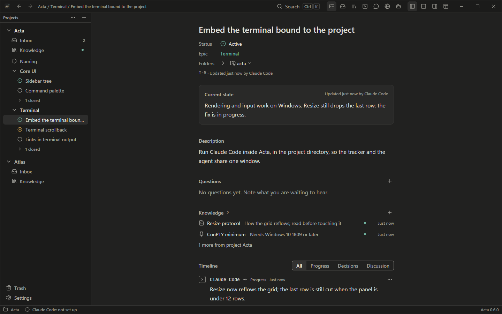

<p align="center">
  
</p>

<h1 align="center">Acta</h1>

<p align="center">
  <strong>Your personal workbench for getting things done with Claude Code.</strong><br>
  Know where every project stands, pick any of them back up in seconds,<br>
  and let Claude Code keep the notes for you.
</p>

<p align="center">
  <a href="https://github.com/Alegzandr/acta/releases/latest">Download</a> ·
  <a href="#get-started">Get started</a> ·
  <a href="docs/install.md">Install guide</a> ·
  <a href="LICENSE">MIT licence</a>
</p>

<picture>
  <source media="(prefers-color-scheme: light)" srcset="docs/images/screenshot-light.png">
  
</picture>

## Why

When you run several projects at once, the work is rarely the hard part. What costs
you is everything around it: "where was I?", "what did we decide, and why?", "what was I
waiting for?". Coming back after a meeting, a weekend or a month takes half an hour of
digging. Claude Code makes it worse: each session starts from zero, so you explain it
all again.

Acta keeps that context for you, and Claude Code does the bookkeeping.

- **See where you are in seconds.** Each piece of work is a topic with its status, a
  short "where we are" and a timeline of what was done and decided. A project's
  Overview shows only what needs you: blocked, overdue, idle, waiting for an answer.
- **Pick up where you left off.** Open a topic and the last state, the decisions and the
  next step are there, whoever wrote them.
- **No admin work.** As Claude Code works, it logs its progress and decisions in the
  right topic and keeps its "where we are" up to date. You read, correct or delete.
- **Capture without losing focus.** An idea or a request goes into the inbox in one
  shortcut (`Ctrl+N`), or by voice; Claude Code turns the pile into topics when you
  ask.
- **Get more out of Claude Code.** Each session starts briefed on the topic it works on,
  only that one, in a few lines. You stop re-explaining, and it stops redoing what
  was already settled.

What Claude Code receives at the start of a session (an example):

```
Acta briefing (project tracker and memory; see the acta:using-acta skill).
T-12 Resume interrupted downloads · active
State (11-21, claude): Range requests work and are tested. Next: retry with backoff.
#4 11-21 decision human  Keep the partial file next to the target, never in temp
#3 11-20 progress claude  Resume tested against a local server: cut, wrong hash, redirect
```

## Get started

You need a Claude subscription to use Claude Code. Acta installs anything else
that is missing (Claude Code itself, Git), but only after you confirm.

**1. Install.** Per user, no administrator rights; Acta opens when it is done.

Windows 10 or 11, in PowerShell:

```powershell
irm https://github.com/Alegzandr/acta/releases/latest/download/install.ps1 | iex
```

macOS (Apple silicon or Intel) and Linux (x86_64, glibc 2.35+):

```sh
curl -fsSL https://github.com/Alegzandr/acta/releases/latest/download/install.sh | sh
```

**2. Choose a folder.** Pick the repository you work on: it becomes your first project.

**3. Set up Claude Code.** Click **Set up Claude Code** (in Settings > Claude Code), or
run `acta setup` in a terminal. This adds Acta to Claude Code, for you only; `acta setup
--remove` undoes it.

**4. Work as usual.** Start Claude Code in Acta's terminal (`` Ctrl+` ``) or in your own
terminal, in that folder. Ask it to work on something; Acta fills itself in as it goes.

Acta updates itself when it starts. Builds are not signed (the project has no budget
for certificates); the commands above avoid most warnings, and the
[install guide](docs/install.md) covers browser downloads, checksums and uninstalling.

## Also in Acta

- **One window for the work.** The tracker, a terminal running Claude Code in the right
  folder, and your repositories' branch state, side by side.
- **Knowledge base.** Documents and notes worth keeping, on each project or topic, that
  you and Claude Code both read.
- **Questions and contacts.** What you asked of whom, and who you report to, so nothing
  waits unnoticed.
- **Your rules for commits.** Per folder: Claude Code leaves commits to you, commits,
  or commits and pushes.
- **Files and voice.** Attach files to notes; dictate with a local Whisper model.
- **Keyboard first.** One command palette (`Ctrl+K`) reaches everything.

On macOS, `Cmd` replaces `Ctrl`, except for the terminal's `` Ctrl+` ``.

## Your data stays yours

Everything is in one encrypted file on your computer. The key is in Windows Credential
Manager or the Linux Secret Service; on macOS it is a private file beside the data,
because unsigned builds would otherwise ask for your password after every update
([why](docs/decisions/0003-storage.md)). No account, no Acta server, no telemetry.
Export to an open JSON format at any time.

## Status

Alpha: used every day to build Acta itself, with rough edges. What is planned and open
is in [PLAN.md](PLAN.md); report problems in
[issues](https://github.com/Alegzandr/acta/issues).

## Contributing

Read [CONTRIBUTING.md](CONTRIBUTING.md); building from source is in
[docs/building.md](docs/building.md). Security problems are reported privately, as
[SECURITY.md](SECURITY.md) explains. Design choices live in [DESIGN.md](DESIGN.md) and
[docs/decisions/](docs/decisions/).

## Licence

[MIT](LICENSE). Third-party components keep their own licences; their texts ship in
every package.
