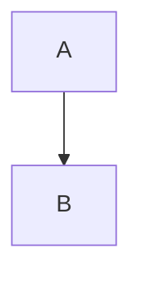

Here is the fix:

```rust
pub fn open(path: &Path, key: &SecretKey) -> Result<Store, Error> { let conn = Connection::open_with_flags(path, OpenFlags::SQLITE_OPEN_READ_WRITE | OpenFlags::SQLITE_OPEN_CREATE)?; conn.pragma_update(None, "key", key.expose())?; Ok(Store { conn }) }
```

And the diff:

```diff
--- a/src/store.rs
+++ b/src/store.rs
@@ -12,3 +12,3 @@
-    let conn = Connection::open(path)?;
+    let conn = Connection::open_with_flags(path, flags)?;
     conn.pragma_update(None, "key", key.expose())?;
```

    indented code
    	with a tab

~~~
tilde fence, no language
~~~



$$
E = mc^2
$$

Costs $5 and $10, and a path: `C:\Users\Alexandre\AppData\Local\Acta`.

```powershell
param([string]$Name = "Alexandre")
# Greets the person who asked.
function Send-Greeting([string]$To) { Write-Host "Hello, $To" -ForegroundColor Green }
Send-Greeting -To $Name
```

```ts
export class Store implements Disposable {
  constructor(private readonly path: string, retries = 3) {}
  async open(key: Uint8Array): Promise<boolean> { return key.length === 32; }
}
```
